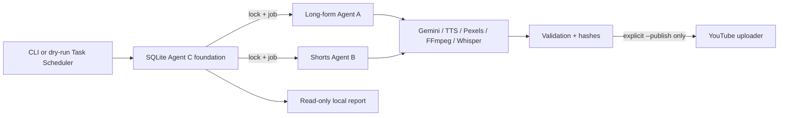

# 🎬 DeedLamp AI — Modular YouTube Channel Automation Platform

An upgraded, modular end-to-end AI publication engine built with Node.js ES Modules, Python, FFmpeg, and Faster-Whisper. It plans, scriptwrites, voice-synthesizes, gathers B-roll, edits, captions, and publishes YouTube Shorts and 4-ACT mini-documentaries hands-free under **The Weird Archivist** persona.

> **Local safety foundation (current branch):** Live YouTube upload is disabled by default. A live scheduled upload happens only when `--publish` is supplied explicitly. The supplied BAT/VBS scheduling path runs `--dry-run` until the workflow is deliberately promoted after review.

## What changed and why

The first orchestration implementation slice addresses the duplicate/concurrent upload risk found in historical logs:

- Added a local SQLite source of truth at `data/orchestration.db` using Node's built-in `node:sqlite` module. No managed database or paid service is used.
- Added the required job lifecycle, transition validation, attempt counts, structured error details, asset paths, source URL storage, validation results, script hashes, rendered-video fingerprints, YouTube IDs, and timestamps.
- Added a SQLite lease that permits only one render/upload job at a time.
- Replaced shared final filenames with durable per-job paths under `output/jobs/<job-id>/final.mp4`.
- Added duplicate script and exact rendered-file fingerprint checks before upload.
- Added secret redaction for structured/error logs.
- Added explicit Gemini model allowlisting. Automatic model/provider fallback is disabled.
- Classifies Gemini and YouTube quota exhaustion as a blocked job instead of attempting a paid fallback.
- Made invalid dimensions and long-form duration violations hard validation failures.
- Added Faster-Whisper transcript export and a word-error-rate gate (maximum `0.25`) against the intended script.
- Added a local operations report and automated SQLite/state/locking/security tests.
- Changed local BAT runners to `--dry-run`. They cannot upload merely because Task Scheduler launches them.

This slice does **not yet** claim production readiness. Citation verification, bounded post-upload status checks, automatic retry scheduling, and scheduler installation scripts remain planned work.

## ₹0-cost and local-only rules

- Keep Google Cloud/Gemini billing disabled. The code allows only `gemini-2.5-flash` and has no paid model fallback.
- SQLite, FFmpeg, Faster-Whisper, reports, locks, job history, renders, and logs stay on this Windows laptop.
- Pexels, Edge TTS, YouTube Data API, and optional Gmail SMTP are the only network integrations currently used.
- Do not configure a paid AI provider, managed Redis/PostgreSQL, paid voice service, hosted queue, or paid monitoring platform.
- A quota error is recorded as `blocked`; it must be retried later within the free allowance.
- Never commit `.env`, OAuth tokens, Gmail app passwords, or API keys.

## Current agent architecture



- **Agent A:** `long.js`; creates 3.5–4.5 minute landscape jobs and artifacts.
- **Agent B:** `short.js`; creates vertical Short jobs and artifacts.
- **Agent C foundation:** `core/job-store.js` and `core/pipeline-run.js`; owns lifecycle transitions, one-job locking, attempts, paths, hashes, and upload identifiers.
- **Master/reporting module:** `orchestrator.js report`; reads SQLite and reports states, recent jobs, repeated failures, and local disk usage. It does not change production jobs.

## Required local software

- Node.js 24 or later (the implementation uses the built-in `node:sqlite` API).
- Python 3 with `faster-whisper` installed locally.
- FFmpeg and ffprobe available on `PATH` to render or validate media.
- Git for local source control.
- Network access only when invoking Gemini, Pexels, Edge TTS, YouTube, or Gmail SMTP.

Install Node dependencies locally:

```powershell
npm ci
```

Verify required binaries:

```powershell
node --version
python --version
python -c "import faster_whisper; print('faster-whisper available')"
ffmpeg -version
ffprobe -version
```

## Environment configuration

Copy `.env.example` to `.env` and replace placeholders locally. Never commit `.env`.

| Variable | Required | Purpose |
|---|---:|---|
| `GEMINI_API_KEY` | Generation | Gemini eligible free-tier access; billing must remain disabled |
| `GEMINI_MODEL` | No | Must remain `gemini-2.5-flash`; no automatic fallback |
| `PEXELS_API_KEY` | Generation | Free Pexels stock-video API access |
| `CLIENT_ID` | Publish/review | Google OAuth client ID for YouTube upload |
| `CLIENT_SECRET` | Publish/review | Google OAuth client secret; never log or commit |
| `REFRESH_TOKEN` | Publish/review | YouTube upload refresh token; never log or commit |
| `EMAIL_USER` | No | Gmail SMTP sender/recipient |
| `EMAIL_PASS` | No | Gmail app password, not the normal account password |
| `ORCHESTRATION_DB_PATH` | No | Local SQLite path; defaults to `data/orchestration.db` |
| `TEMP_DIR` | No | Disposable render workspace; defaults to `temp` |
| `OUTPUT_DIR` | No | Durable per-job output; defaults to `output/jobs` |
| `PUBLISH_HOUR_LOCAL` | No | Scheduled publish hour; defaults to `18` |
| `PUBLISH_TIMEZONE` | No | Reporting timezone; defaults to `Asia/Kolkata` |
| `MAX_JOB_ATTEMPTS` | No | Maximum recorded attempts; defaults to `3` |
| `LOCK_LEASE_MINUTES` | No | Local render/upload lease; defaults to `180` |

## Safe commands

```powershell
# Syntax and unit tests; does not use network APIs
npm run check
npm test

# Initialize/migrate local SQLite
npm run db:init

# Read-only local operations report
npm run report
npm run report -- --json

# Safe default: produces locally and does not upload
node short.js
node long.js

# Full pipeline with simulated upload; still uses Gemini/Pexels/Edge TTS
node short.js --dry-run
node long.js --dry-run

# Local render with no upload simulation
node short.js --skip-upload
node long.js --skip-upload

# Private YouTube upload requiring human review
node short.js --review
node long.js --review

# Live scheduled upload: explicit authorization every invocation
node short.js --publish
node long.js --publish
```

Do not combine `--dry-run`, `--skip-upload`, `--review`, or `--publish`.

## SQLite job lifecycle

Normal path:

```text
queued → researching → scripted → rendering → validating
       → ready_to_publish → uploading → published
```

Failure/manual states:

```text
retryable_failure | blocked | failed | needs_review
```

Quota exhaustion and a busy production lock become `blocked`. A failed validation never reaches `uploading`. Private review uploads become `needs_review`. The current reporting module does not silently requeue or edit jobs.

## Windows Task Scheduler

The checked-in `run-short.bat` and `run-long.bat` currently invoke `--dry-run`. Existing `silent-short.vbs` and `silent-long.vbs` call those safe runners.

For a safe test task:

1. Use **Create Task**, not Basic Task, and run only while the local user is logged in during initial validation.
2. Set the action to `wscript.exe` with the full path to `silent-short.vbs` or `silent-long.vbs` as its argument.
3. Prevent starting a new instance when the task is already running. SQLite also enforces the production lock.
4. Keep the BAT runner on `--dry-run` until a complete dry run passes and its SQLite record/output are reviewed.
5. Do not switch a scheduled command to `--publish` until citation and transcript-comparison gates are implemented and verified.

No task is automatically created or modified by this repository.

## Troubleshooting

| Symptom | Safe response |
|---|---|
| `PRODUCTION_LOCKED` | Another job owns the render/upload lease. Do not start another render; inspect `npm run report`. |
| `FREE_TIER_QUOTA_EXHAUSTED` | Job is blocked. Wait for free quota reset; do not enable billing or change providers. |
| `YOUTUBE_FREE_QUOTA_EXHAUSTED` | Job is blocked. Retry after quota reset; do not re-upload blindly. |
| `DUPLICATE_SCRIPT_HASH` | Review the referenced earlier job before generating or uploading again. |
| `DUPLICATE_VIDEO_FINGERPRINT` | Exact rendered content already exists in another job; do not upload it again. |
| FFmpeg/ffprobe missing | Install FFmpeg locally and add its `bin` directory to Windows `PATH`. |
| Wrong dimensions/duration | Validation fails before upload. Correct the render settings; never bypass the gate. |
| Gemini fetch failure | Treat as retryable only when it is not a quota/authentication error. Check local connectivity later. |
| Task Scheduler access denied | Inspect or update the task manually from an elevated Windows Task Scheduler session. |

## Known limitations

- Gemini free-tier eligibility and quota depend on the Google account/project configuration; code cannot guarantee an account has billing disabled.
- Edge TTS is network-dependent and may change availability.
- Source URLs and citation fields exist in SQLite, but authoritative allowlist retrieval and claim-level verification are not implemented yet.
- Faster-Whisper transcript comparison uses a simple normalized word-error-rate threshold of `0.25`; it may need calibration for names, dates, and accent-specific recognition.
- YouTube upload IDs are persisted immediately after a successful response, but bounded 30-second/2-minute/5-minute verification is not implemented yet.
- Automatic exponential-backoff requeue scheduling is not implemented yet; failures are recorded for deterministic future handling.
- The repository still contains legacy `index.js` and `long-form.js`; do not schedule or run them because they contain the previous direct-publication implementation.
- GitHub Actions is not configured. Prefer local tests; any future CI must remain charge-free or use a self-hosted runner.

---

## 📌 Executive Summary & Brand Identity

**DeedLamp** is a story-driven educational YouTube channel hosted by **The Weird Archivist** — a persona that unearths strange historical anomalies, biological extremes, psychological phenomena, physics edge cases, and engineering disasters.

The system features a modular architecture:
1. **Short-Form Agent (`short.js`)**: Generates 25-second vertical (9:16) Shorts with mid-scene story openers, 4-beat narrative beats, dynamic Whisper captions, and SEO-first metadata.
2. **Long-Form Agent (`long.js`)**: Generates 4-minute 16:9 landscape mini-documentaries ("The Archive" series) featuring 4-ACT storytelling, 8 landscape B-roll scenes, channel logo watermark overlay, chapter markers, and a verbal subscribe CTA.
3. **Preflight & Production Safeguards**: Includes automated system preflight checks (`core/preflight.js`), content quality gates (`core/quality-gate.js`), media render integrity verification (`core/validator.js`), near-duplicate topic similarity protection (`core/memory.js`), structured stage timing logs (`core/logger.js`), analytics performance tracking (`core/analytics.js`), and dry-run simulation modes.
4. **Scheduled Uploads**: Uses YouTube's `publishAt` API to schedule publishing at peak engagement time (18:00 local time) in Category `27` (Education).

---

## 🛠️ Modular System Architecture

```mermaid
flowchart TD
    A[CLI / Scheduler Trigger: short.js | long.js] --> B[core/preflight.js]
    B -->|Passed| C[core/memory.js: Near-Duplicate Check]

    %% Memory & Prompts
    C --> F1[prompts/short-prompt.js]
    C --> F2[prompts/long-prompt.js]

    %% Gemini AI Brain & Quality Gate
    F1 & F2 --> G[core/gemini.js: Gemini 2.5 Flash]
    G --> H[core/quality-gate.js: Anti-AI Quality Gate]
    H -->|Passed| I[core/tts.js: EdgeTTS Christopher/Ryan/Guy]

    %% B-Roll & Editing
    H --> J[core/pexels.js: Pexels API HD Clips]
    J & I --> K1[core/ffmpeg-short.js]
    J & I --> K2[core/ffmpeg-long.js + Logo Overlay]
    K1 & K2 --> L[core/captions.js: burn_captions.py - Whisper]

    %% Validation & Distribution
    L --> M[core/validator.js: Media Render Integrity Check]
    M -->|Passed| N{Dry-Run / Human Review?}
    N -->|Live Schedule| O[core/youtube.js: Upload publishAt 18:00]
    N -->|Simulation| P[Log Dry-Run Report]
    O --> Q[core/analytics.js: Record Metrics Stub]
```

---

## 📂 Codebase & Directory Layout

```
k:\1.Projects\youtube\
├── core/
│   ├── identity.js          # Channel persona, voice weights, banned words & openers
│   ├── memory.js            # JSON memory read/write & Jaccard near-duplicate topic detection
│   ├── gemini.js            # Gemini API wrapper with retry & JSON parsing
│   ├── pexels.js            # Pexels B-roll fetcher with fallback handling
│   ├── tts.js               # EdgeTTS synthesizer module
│   ├── ffmpeg-short.js      # Short-form 1080x1920 9:16 FFmpeg pipeline
│   ├── ffmpeg-long.js       # Long-form 1920x1080 16:9 FFmpeg pipeline (8 scenes + logo overlay)
│   ├── captions.js          # Whisper caption runner wrapper
│   ├── preflight.js         # System & env preflight validation suite
│   ├── quality-gate.js      # Script & content quality validator
│   ├── validator.js         # Media render integrity checker (ffprobe, resolution, audio)
│   ├── logger.js            # Structured execution & stage timing logger
│   ├── analytics.js        # Performance metrics tracker for data/analytics.json
│   └── youtube.js           # YouTube upload module (dry-run, human review, category 27, publishAt 18:00)
├── prompts/
│   ├── short-prompt.js      # Story-first 4-beat Short prompt & description builder
│   └── long-prompt.js       # 4-ACT documentary prompt with outro CTA & chapter generator
├── data/
│   ├── memory.json          # Structured database of published topics & slugs
│   └── analytics.json       # Performance analytics tracking database
├── logs/                    # Structured JSONL execution logs (execution.jsonl)
├── archive/                 # Rollback backup of original legacy scripts (.bak)
├── assets/
│   ├── logo.png             # Channel watermark logo
│   └── arial.ttf            # Subtitle font
├── short.js                 # Primary Short-Form Agent (supports --dry-run, --review, --skip-upload)
├── long.js                  # Primary Long-Form Agent (supports --dry-run, --review, --skip-upload)
├── smoke-test.js            # End-to-end automated smoke test suite
├── run-short.bat            # Windows batch runner for short.js
├── run-long.bat             # Windows batch runner for long.js
├── silent-short.vbs         # Hidden background VBScript runner for Shorts
├── silent-long.vbs          # Hidden background VBScript runner for Long-Form
├── burn_captions.py         # Faster-Whisper caption hardburner with canvas scaling
├── process_videos.py        # Standalone batch video processor
└── get-token.js             # OAuth2 refresh token setup helper
```

---

## 🎙️ Voice & Persona Identity

- **Persona**: **The Weird Archivist** — authoritative, curious, urgent, slightly conspiratorial.
- **Voice Weights**:
  - **Primary (60% weight)**: `en-US-ChristopherNeural` (Main voice of the Archivist)
  - **Alternates (20% weight each)**: `en-GB-RyanNeural` (Historical gravitas) & `en-US-GuyNeural` (Psychological/nature warmth)
- **Banned Vocabulary**: Words like *"fascinating"*, *"interesting"*, *"remarkable"*, *"mind-blowing"*, *"incredible"*, and AI openers like *"Did you know"* or *"Imagine if"* are strictly prohibited in prompt generation.

---

## 🎬 Narrative Structures

### Short-Form (4-Beat Structure)
- **Beat 1 — The Drop (0–4s)**: Open mid-scene with a specific name, date, or number. No preamble.
- **Beat 2 — The Strange Detail (5–12s)**: Sensory and paradoxical details.
- **Beat 3 — The Reframe (13–20s)**: Emotional payload or twist.
- **Beat 4 — The Loop (21–25s)**: Unresolved closing image inviting repeat watch.

### Long-Form (4-ACT Documentary Structure)
- **ACT 1 — The Inciting Detail (0:00–0:45)**: Specific real fact opening.
- **ACT 2 — The Context (0:45–1:45)**: Human element + sensory detail.
- **ACT 3 — The Escalation (1:45–3:00)**: Turn of events and escalation.
- **ACT 4 — The Echo (3:00–3:45)**: Lingering human takeaway.
- **Outro (3:45–4:00)**: Spoken subscribe CTA: *"If you want more from The Archive, subscribe. The next one is stranger than this."*
- **8 Scene B-Roll Clips**: 8 distinct landscape footage segments per video.

---

## 🚀 Execution & CLI Commands

### 1. Run Automated Smoke Test Suite
Validates preflight, prompt generation, quality gates, rendering, and dry-run uploads across both Shorts and Long-form:
```bash
node smoke-test.js
```

### 2. Run Short-Form Agent
```bash
node short.js [options]
```
**Available CLI Flags:**
- `--dry-run`: Full pipeline test without uploading to YouTube.
- `--review`: Uploads video as a Private Draft for manual review in YouTube Studio.
- `--publish`: Explicitly permits a live scheduled upload.
- `--skip-upload`: Generates and renders video locally without uploading.

### 3. Run Long-Form Agent
```bash
node long.js [options]
```
**Available CLI Flags:**
- `--dry-run`: Full pipeline test without uploading to YouTube.
- `--review`: Uploads video as a Private Draft for manual review in YouTube Studio.
- `--publish`: Explicitly permits a live scheduled upload.
- `--skip-upload`: Generates and renders video locally without uploading.

### 4. Windows Task Scheduler
During stabilization, Windows Task Scheduler may run `silent-short.vbs` and `silent-long.vbs` only in their checked-in `--dry-run` configuration. Do not schedule `--publish` until all remaining safety gates pass.
