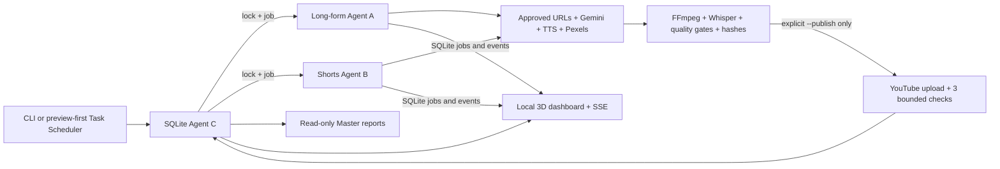

# 🎬 DeedLamp AI — Modular YouTube Channel Automation Platform

An upgraded, modular end-to-end content engine built with Node.js ES Modules, Python, FFmpeg, and Faster-Whisper. It plans, scriptwrites, voice-synthesizes, gathers B-roll, edits, captions, validates, and—only with explicit authorization—publishes YouTube Shorts and 4-ACT mini-documentaries under **The Weird Archivist** persona.

> **Local safety rule:** Live YouTube upload is disabled by default. A live scheduled upload requires both an explicit `--publish` argument and local `ALLOW_AUTO_PUBLISH=true`. The scheduler installer is preview-only unless `-Apply` is supplied, and publish scheduling additionally requires `-AllowPublish`.

## What changed and why

The local orchestration implementation addresses the duplicate/concurrent upload risk found in historical logs and completes the initial four-module design:

- Added a local SQLite source of truth at `data/orchestration.db` using Node's built-in `node:sqlite` module. No managed database or paid service is used.
- Added the required job lifecycle, transition validation, attempt counts, structured error details, asset paths, source URL storage, validation results, script hashes, rendered-video fingerprints, YouTube IDs, and timestamps.
- Added a SQLite lease that permits only one render/upload job at a time.
- Replaced shared final filenames with durable per-job paths under `output/jobs/<job-id>/final.mp4`.
- Added duplicate script and exact rendered-file fingerprint checks before upload.
- Added secret redaction for structured/error logs.
- Added explicit Gemini model allowlisting. Automatic model/provider fallback is disabled.
- Classifies Gemini and YouTube quota exhaustion as a blocked job instead of attempting a paid fallback.
- Made invalid dimensions and long-form duration violations hard validation failures.
- Added Faster-Whisper transcript export and a word-error-rate gate (maximum `0.25`) against the intended script.
- Added a local operations report and automated SQLite/state/locking/security tests.
- Changed local BAT runners to `--dry-run`. They cannot upload merely because Task Scheduler launches them.
- Added an authoritative-host allowlist plus a human-reviewed topic catalog containing exact URLs. Source pages are fetched with native HTTPS and redirect/content/size limits; Gemini never invents the URLs.
- Added claim-level evidence checks, source manifests, description citations, and rejection of unsupported high-risk factual sentences.
- Added deterministic exponential retries with bounded attempts and a due-job worker. Quota blocks wait; they never switch to a paid model or provider.
- Added YouTube checks only at 30 seconds, 2 minutes, and 5 minutes. Ambiguous upload responses go to `needs_review`; recovery searches for a durable job marker instead of blindly re-uploading.
- Added preview-first Windows Task Scheduler installation/removal scripts and isolated the two legacy direct-publication entry points.
- Added daily/weekly Markdown and JSON operations reports under ignored local storage.
- Added a loopback-only browser dashboard with a hierarchical 3D agent map, live SQLite event streaming, job drill-downs, schedule visibility, validation health, upload history, and durable email notification auditing. It uses no CDN, hosted database, or paid monitoring service.
- Reconciled PR #2 with the newer `main` safety work: project-root paths are now independent of the launch directory, Pexels downloads use bounded HTTPS streaming and atomic temporary files, Python caption execution avoids shell interpolation, assets live under `assets/`, and archived files were preserved.
- Added an optional manual-only, self-hosted CI workflow. It never runs on push or pull request and therefore does not consume GitHub-hosted CI minutes automatically.

## ₹0-cost and local-only rules

- Keep Google Cloud/Gemini billing disabled. The code allows only `gemini-2.5-flash` and has no paid model fallback.
- SQLite, FFmpeg, Faster-Whisper, reports, locks, job history, renders, and logs stay on this Windows laptop.
- Pexels, Edge TTS, YouTube Data API, and optional Gmail SMTP are the only network integrations currently used.
- Do not configure a paid AI provider, managed Redis/PostgreSQL, paid voice service, hosted queue, or paid monitoring platform.
- A quota error is recorded as `blocked`; it must be retried later within the free allowance.
- Never commit `.env`, OAuth tokens, Gmail app passwords, or API keys.

## Current agent architecture



- **Agent A:** `long.js`; creates 3.5–4.5 minute landscape jobs and artifacts.
- **Agent B:** `short.js`; creates vertical Short jobs and artifacts.
- **Agent C:** `core/job-store.js`, `core/pipeline-run.js`, and `orchestrator.js`; owns lifecycle transitions, one-job locking, retries, paths, hashes, upload identifiers, recovery, and scheduling commands. It does not invent content.
- **Master/reporting module:** `core/reporting.js` plus `orchestrator.js report`; reads SQLite and reports states, recent jobs, repeated failures, next retry, configured schedules, and disk usage. It does not alter production jobs.
- **Browser dashboard:** `dashboard/server.js` and `dashboard/public/`; reads the same SQLite jobs/events through a loopback-only local API and pushes refreshed snapshots to the browser. It has no production mutation endpoints.

## Required local software

- Node.js 24 or later (the implementation uses the built-in `node:sqlite` API).
- Python 3 with `faster-whisper` installed locally.
- FFmpeg and ffprobe available on `PATH`, configured with `FFMPEG_PATH`/`FFPROBE_PATH`, or unpacked beneath ignored `tools/ffmpeg/`.
- Git for local source control.
- Network access only when invoking Gemini, Pexels, Edge TTS, YouTube, or Gmail SMTP.

Install Node dependencies locally:

```powershell
npm ci
```

Verify required binaries:

```powershell
node --version
python --version
python -c "import faster_whisper; print('faster-whisper available')"
npm run db:init
npm run check
```

## Environment configuration

Copy `.env.example` to `.env` and replace placeholders locally. Never commit `.env`.

| Variable | Required | Purpose |
|---|---:|---|
| `GEMINI_API_KEY` | Generation | Gemini eligible free-tier access; billing must remain disabled |
| `GEMINI_MODEL` | No | Must remain `gemini-2.5-flash`; no automatic fallback |
| `PEXELS_API_KEY` | Generation | Free Pexels stock-video API access |
| `CLIENT_ID` | Publish/review | Google OAuth client ID for YouTube upload |
| `CLIENT_SECRET` | Publish/review | Google OAuth client secret; never log or commit |
| `REFRESH_TOKEN` | Publish/review | YouTube upload refresh token; never log or commit |
| `ALLOW_AUTO_PUBLISH` | Publish | Must explicitly be `true` in addition to `--publish`; defaults to `false` |
| `EMAIL_USER` | No | Gmail SMTP sender/recipient |
| `EMAIL_PASS` | No | Gmail app password, not the normal account password |
| `ORCHESTRATION_DB_PATH` | No | Local SQLite path; defaults to `data/orchestration.db` |
| `TEMP_DIR` | No | Disposable render workspace; defaults to `.local/temp` |
| `OUTPUT_DIR` | No | Durable per-job output; defaults to `output/jobs` |
| `LOG_DIR` | No | Local log directory; defaults to `logs` |
| `REPORT_DIR` | No | Generated local reports; defaults to `reports/generated` |
| `DASHBOARD_PORT` | No | Loopback dashboard port; defaults to `4317` |
| `DASHBOARD_REFRESH_MS` | No | SQLite-to-browser update interval; defaults to `2000`, minimum `1000` |
| `FFMPEG_PATH` | No | Explicit local FFmpeg executable; auto-detected when blank |
| `FFPROBE_PATH` | No | Explicit local ffprobe executable; auto-detected when blank |
| `PUBLISH_HOUR_LOCAL` | No | Scheduled publish hour; defaults to `18` |
| `PUBLISH_TIMEZONE` | No | Reporting timezone; defaults to `Asia/Kolkata` |
| `FACT_CHECK_MIN_CONFIDENCE` | No | Minimum fact-check confidence; defaults to `80` |
| `TRUSTED_SOURCE_DOMAINS` | No | Optional comma-separated additions to the reviewed source allowlist |
| `NETWORK_TIMEOUT_MS` | No | Bounded network-operation timeout; defaults to `30000` |
| `PROCESS_TIMEOUT_MS` | No | Bounded local process timeout; defaults to `1800000` |
| `PYTHON_COMMAND` | No | Local Python launcher; defaults to `python` |
| `MAX_JOB_ATTEMPTS` | No | Maximum recorded attempts; defaults to `3` |
| `RETRY_BASE_SECONDS` | No | First retry delay; defaults to `300` |
| `RETRY_MAX_SECONDS` | No | Maximum retry delay/quota wait; defaults to `21600` |
| `LOCK_LEASE_MINUTES` | No | Local render/upload lease; defaults to `180` |

### Free API credentials and quota safety

- Create Gemini API credentials only in a project/account eligible for the free tier, leave billing disabled, and keep `GEMINI_MODEL=gemini-2.5-flash`. The code refuses unapproved model names and has no fallback provider.
- Obtain a Pexels API key under Pexels' free API terms. Failed or empty downloads fail validation; they are not replaced by a paid stock provider.
- Enable YouTube Data API access without enabling billing, create OAuth desktop credentials, and generate a refresh token locally with `node get-token.js`. Never commit the downloaded client secret or `.env`.
- YouTube uploads consume free API quota. When quota is exhausted the job is blocked for later handling; do not create extra projects to evade limits.
- Gmail SMTP is optional. Use an app password only; if it is absent, notification warnings are local and production processing remains deterministic.
- Fact checking never uses Gemini Google Search grounding. Add reviewed exact pages to `config/approved-topics.json`; their hosts must also exist in `config/approved-sources.json`.

## Safe commands

```powershell
# Syntax and unit tests; does not use network APIs
npm run check
npm test

# Initialize/migrate local SQLite
npm run db:init

# Read-only local operations report
npm run report
npm run report -- --json
npm run report:daily
npm run report:weekly

# Read-only local browser dashboard
npm run dashboard
# Or start it and open the local page automatically
npm run dashboard:open

# Inspect a job and run deterministic due retries
node orchestrator.js job <job-id>
npm run retry:due

# Recover an ambiguous upload by its durable marker; never blindly retries
npm run upload:recover -- <job-id>

# Safe default: produces locally and does not upload
node short.js
node long.js

# Full pipeline with simulated upload; still uses Gemini/Pexels/Edge TTS
node short.js --dry-run
node long.js --dry-run

# Local render with no upload simulation
node short.js --skip-upload
node long.js --skip-upload

# Private YouTube upload requiring human review
node short.js --review
node long.js --review

# Live scheduled upload: also requires ALLOW_AUTO_PUBLISH=true in local .env
node short.js --publish
node long.js --publish

# Network-free 3.5-minute Agent A renderer verification
npm run verify:long-render
```

Do not combine `--dry-run`, `--skip-upload`, `--review`, or `--publish`. Add `--topic=<approved-topic-id>` to select an entry from the curated catalog.

## Local 3D browser dashboard

Start the dashboard and open `http://127.0.0.1:4317`:

```powershell
npm run dashboard
```

The dashboard is deliberately local and read-only:

- It binds only to the loopback interface (`127.0.0.1`) and refuses non-loopback hosts.
- It uses native Node HTTP, local HTML/CSS/JavaScript, a strict Content Security Policy, and no CDN or cloud dashboard.
- `/api/dashboard` returns the current hierarchy snapshot, `/api/jobs/<job-id>` returns a job timeline, and `/api/events` provides server-sent live updates. There are no create, retry, upload, publish, or delete endpoints.
- Master appears at the top of the hierarchy, Agent C is the operational parent, and Agents A/B are the production children. Selecting a node changes the detail view.
- Agent A/B panels show the latest job, last recorded YouTube upload, state counts, validation results, and most recent email outcome.
- Agent C shows SQLite lifecycle decisions, retries, resource locks, upload checks, and notification events. The job drawer exposes the complete recorded timeline.
- Email states are `sent`, `failed`, `skipped`, `not_required`, `not_applicable`, or `not_recorded`. Future upload and meaningful-failure emails are recorded as SQLite job events; existing historical jobs correctly remain `not_recorded`.
- An exact upcoming time is shown only when a future `publish_at` or `scheduled_for` exists in SQLite. Otherwise the UI labels 18:00 daily Shorts and Sunday 18:00 long-form values as candidate schedules and separately reports whether each Windows task is installed.

Health meanings:

| Health | Meaning |
|---|---|
| `working` | An agent has an active research/script/render/validation/upload job or Agent C owns a live resource lock |
| `healthy` | Recent jobs are ready/published and no attention state is present |
| `warning` | At least one job is blocked, retryable, or needs human review |
| `critical` | The latest relevant job failed permanently |
| `idle` | No job has been recorded for that production agent |

## SQLite job lifecycle

Normal path:

```text
queued → researching → scripted → rendering → validating
       → ready_to_publish → uploading → published
```

Failure/manual states:

```text
retryable_failure | blocked | failed | needs_review
```

Quota exhaustion and a busy production lock become `blocked`. Retry timing is `min(RETRY_MAX_SECONDS, RETRY_BASE_SECONDS × 2^(attempt-1))`; no job exceeds `MAX_JOB_ATTEMPTS`. A failed validation never reaches `uploading`. Private review and ambiguous upload responses become `needs_review`. Upload-capable retries always require manual recovery/review. The Master reporting module never requeues or edits jobs.

## Windows Task Scheduler

The checked-in BAT/VBS runners remain dry-run-only. The PowerShell installer directly invokes Node with an explicit mode and creates no task unless `-Apply` is supplied.

```powershell
# Preview Agent C every 15 minutes and Shorts daily at 18:00; changes nothing
powershell -ExecutionPolicy Bypass -File scripts\install-scheduled-tasks.ps1

# Register safe dry-run tasks after reviewing the preview
powershell -ExecutionPolicy Bypass -File scripts\install-scheduled-tasks.ps1 -Apply

# Optional local-only weekly long-form task
powershell -ExecutionPolicy Bypass -File scripts\install-scheduled-tasks.ps1 -Mode LocalOnly -IncludeLong -Apply

# Preview removal, then explicitly remove if desired
powershell -ExecutionPolicy Bypass -File scripts\remove-scheduled-tasks.ps1
powershell -ExecutionPolicy Bypass -File scripts\remove-scheduled-tasks.ps1 -Apply
```

The installer sets `MultipleInstances=IgnoreNew`, an execution limit, the repository working directory, a daily 18:00 Shorts default, an optional Sunday 18:00 long run, and a 15-minute due-retry check. Publish scheduling additionally requires both `-Mode Publish` and `-AllowPublish`; do not enable it until a real review upload is manually approved.

## Troubleshooting

| Symptom | Safe response |
|---|---|
| `PRODUCTION_LOCKED` | Another job owns the render/upload lease. Do not start another render; inspect `npm run report`. |
| `FREE_TIER_QUOTA_EXHAUSTED` | Job is blocked. Wait for free quota reset; do not enable billing or change providers. |
| `YOUTUBE_FREE_QUOTA_EXHAUSTED` | Job is blocked. Retry after quota reset; do not re-upload blindly. |
| `APPROVED_TOPIC_CATALOG_EXHAUSTED` | Review and add exact authoritative URLs to the curated topic catalog; do not ask Gemini to invent URLs. |
| `CITATION_VALIDATION_FAILED` | A claim or high-risk script sentence could not be mapped to fetched evidence. Review sources or regenerate; never bypass it. |
| Ambiguous YouTube response | Leave the job in `needs_review`, then run `npm run upload:recover -- <job-id>` after checking YouTube Studio. |
| `DUPLICATE_SCRIPT_HASH` | Review the referenced earlier job before generating or uploading again. |
| `DUPLICATE_VIDEO_FINGERPRINT` | Exact rendered content already exists in another job; do not upload it again. |
| FFmpeg/ffprobe missing | Install/unpack FFmpeg locally, add `bin` to `PATH`, set explicit executable paths, or use ignored `tools/ffmpeg/`. |
| Wrong dimensions/duration | Validation fails before upload. Correct the render settings; never bypass the gate. |
| Gemini fetch failure | Treat as retryable only when it is not a quota/authentication error. Check local connectivity later. |
| Task Scheduler access denied | Inspect or update the task manually from an elevated Windows Task Scheduler session. |
| Dashboard port already in use | Set an unused local port such as `DASHBOARD_PORT=4318` in `.env`, then restart `npm run dashboard`. |
| Dashboard says `not_installed` | This is informational. Preview or explicitly apply the Task Scheduler installer; the dashboard never installs tasks itself. |
| Dashboard says email `not_recorded` | Historical job has no durable notification event. New upload/meaningful-failure attempts record `sent`, `failed`, or `skipped`. |
| Dashboard says `Reconnecting` | Confirm the local dashboard process is still running. The browser falls back to periodic local API reads while SSE reconnects. |

## Known limitations

- Gemini free-tier eligibility and quota depend on the Google account/project configuration; code cannot guarantee an account has billing disabled.
- Edge TTS is network-dependent and may change availability.
- The curated topic catalog is intentionally small; every new topic and exact URL requires human review before it can be generated.
- Claim matching is deterministic lexical evidence matching, not a complete semantic fact checker. Unsupported statistics/high-risk statements are rejected, but human editorial review remains required.
- Faster-Whisper transcript comparison uses a simple normalized word-error-rate threshold of `0.25`; it may need calibration for names, dates, and accent-specific recognition.
- YouTube verification stops after three checks. Processing that is still incomplete at five minutes becomes `needs_review`; there is no continuous polling.
- Ambiguous upload recovery searches only the most recent 50 channel uploads for the durable job reference. If it cannot prove identity, it does not retry.
- `index.js` is a safe command router and `long-form.js` is a compatibility wrapper. The archived legacy implementations remain under `archive/`; neither wrapper enables live publishing by itself.
- A real API-backed long dry run may be blocked until Gemini's free quota resets. `npm run verify:long-render` verifies Agent A's network-free FFmpeg path independently.
- Candidate dashboard schedule times are configuration projections, not proof that a Windows task exists. Exact per-job times come only from SQLite, and scheduler installation status can be `unavailable` when Windows denies read access.
- The dashboard reports YouTube IDs and bounded processing checks already stored locally; it does not poll channel analytics or YouTube continuously.
- The live feed refreshes snapshots at a bounded local interval (two seconds by default), not on every SQLite write instruction.
- GitHub Actions is manual-only and targets a self-hosted runner. No push/PR trigger or GitHub-hosted runner is configured; prefer the local commands unless you intentionally register your laptop as a runner.

## Verification record

- Local unit suite after PR #2 conflict resolution: 31 tests passed, covering SQLite lifecycle/migrations, cross-connection leases, retry timing/max attempts, quota blocking, secret redaction/artifact scanning, transcript WER, approved-source security, claim validation, Master report immutability, notification auditing, dashboard hierarchy/API/SSE behavior, publish-time timezone handling, and bounded YouTube verification.
- Short dry run: complete pipeline passed with job `41ef914d-622e-4167-8cf2-6df7dd9733f7`; output is 1080×1920, 22.3 seconds, includes audio/captions, and was not uploaded.
- Long renderer fixture: passed at 1920×1080 and 212 seconds with H.264 video, AAC audio, eight scene inputs, and logo overlay; it never used a network API.
- Real Chelyabinsk long dry run: authoritative sources were fetched, then Gemini returned `FREE_TIER_QUOTA_EXHAUSTED`; job `782d5abc-03a9-4c48-af53-4ce72fd366f6` is safely blocked with a later retry time.
- No real/private YouTube upload was run because this repository has no explicit authorization flag for a test upload. The upload verifier is covered with mocked YouTube responses.
- Browser verification: the real local dashboard loaded without console errors, displayed the four-node hierarchy, updated over SSE without reload, opened job/Agent C drill-downs, filtered attention jobs, and passed a 390×844 mobile overflow check.

---

## 📌 Executive Summary & Brand Identity

**DeedLamp** is a story-driven educational YouTube channel hosted by **The Weird Archivist** — a persona that unearths strange historical anomalies, biological extremes, psychological phenomena, physics edge cases, and engineering disasters.

The system features a modular architecture:
1. **Short-Form Agent (`short.js`)**: Generates 25-second vertical (9:16) Shorts with mid-scene story openers, 4-beat narrative beats, dynamic Whisper captions, and SEO-first metadata.
2. **Long-Form Agent (`long.js`)**: Generates 4-minute 16:9 landscape mini-documentaries ("The Archive" series) featuring 4-ACT storytelling, 8 landscape B-roll scenes, channel logo watermark overlay, chapter markers, and a verbal subscribe CTA.
3. **Preflight & Production Safeguards**: Includes automated system preflight checks (`core/preflight.js`), content quality gates (`core/quality-gate.js`), media render integrity verification (`core/validator.js`), near-duplicate topic similarity protection (`core/memory.js`), structured stage timing logs (`core/logger.js`), analytics performance tracking (`core/analytics.js`), and dry-run simulation modes.
4. **Scheduled Uploads**: Uses YouTube's `publishAt` API to schedule publishing at peak engagement time (18:00 local time) in Category `27` (Education).

---

## 🛠️ Modular System Architecture

```mermaid
flowchart TD
    A[CLI / Scheduler Trigger: short.js | long.js] --> B[core/preflight.js]
    B -->|Passed| C[core/memory.js: Near-Duplicate Check]

    %% Memory & Prompts
    C --> F1[prompts/short-prompt.js]
    C --> F2[prompts/long-prompt.js]

    %% Gemini AI Brain & Quality Gate
    F1 & F2 --> G[core/gemini.js: Gemini 2.5 Flash]
    G --> H[core/quality-gate.js: Anti-AI Quality Gate]
    H -->|Passed| I[core/tts.js: EdgeTTS Christopher/Ryan/Guy]

    %% B-Roll & Editing
    H --> J[core/pexels.js: Pexels API HD Clips]
    J & I --> K1[core/ffmpeg-short.js]
    J & I --> K2[core/ffmpeg-long.js + Logo Overlay]
    K1 & K2 --> L[core/captions.js: burn_captions.py - Whisper]

    %% Validation & Distribution
    L --> M[core/validator.js: Media Render Integrity Check]
    M -->|Passed| N{Dry-Run / Human Review?}
    N -->|Live Schedule| O[core/youtube.js: Upload publishAt 18:00]
    N -->|Simulation| P[Log Dry-Run Report]
    O --> Q[core/analytics.js: Record Metrics Stub]
```

---

## 📂 Codebase & Directory Layout

```
k:\1.Projects\youtube\
├── core/
│   ├── identity.js          # Channel persona, voice weights, banned words & openers
│   ├── memory.js            # JSON memory read/write & Jaccard near-duplicate topic detection
│   ├── gemini.js            # Gemini API wrapper with retry & JSON parsing
│   ├── pexels.js            # Pexels B-roll fetcher with fallback handling
│   ├── tts.js               # EdgeTTS synthesizer module
│   ├── ffmpeg-short.js      # Short-form 1080x1920 9:16 FFmpeg pipeline
│   ├── ffmpeg-long.js       # Long-form 1920x1080 16:9 FFmpeg pipeline (8 scenes + logo overlay)
│   ├── captions.js          # Whisper caption runner wrapper
│   ├── preflight.js         # System & env preflight validation suite
│   ├── quality-gate.js      # Script & content quality validator
│   ├── validator.js         # Media render integrity checker (ffprobe, resolution, audio)
│   ├── logger.js            # Structured execution & stage timing logger
│   ├── analytics.js        # Performance metrics tracker for ignored .runtime/analytics.json
│   └── youtube.js           # YouTube upload module (dry-run, human review, category 27, publishAt 18:00)
├── prompts/
│   ├── short-prompt.js      # Story-first 4-beat Short prompt & description builder
│   └── long-prompt.js       # 4-ACT documentary prompt with outro CTA & chapter generator
├── data/
│   ├── memory.example.json  # Non-secret initial-state example
│   └── analytics.example.json # Non-secret analytics example
├── .runtime/                # Ignored local topic memory and analytics state
├── logs/                    # Structured JSONL execution logs (execution.jsonl)
├── archive/                 # Rollback backup of original legacy scripts (.bak)
├── assets/
│   ├── logo.png             # Channel watermark logo
│   └── arial.ttf            # Subtitle font
├── short.js                 # Primary Short-Form Agent (supports --dry-run, --review, --skip-upload)
├── long.js                  # Primary Long-Form Agent (supports --dry-run, --review, --skip-upload)
├── smoke-test.js            # End-to-end automated smoke test suite
├── run-short.bat            # Windows batch runner for short.js
├── run-long.bat             # Windows batch runner for long.js
├── silent-short.vbs         # Hidden background VBScript runner for Shorts
├── silent-long.vbs          # Hidden background VBScript runner for Long-Form
├── burn_captions.py         # Faster-Whisper caption hardburner with canvas scaling
├── process_videos.py        # Standalone batch video processor
└── get-token.js             # OAuth2 refresh token setup helper
```

---

## 🎙️ Voice & Persona Identity

- **Persona**: **The Weird Archivist** — authoritative, curious, urgent, slightly conspiratorial.
- **Voice Weights**:
  - **Primary (60% weight)**: `en-US-ChristopherNeural` (Main voice of the Archivist)
  - **Alternates (20% weight each)**: `en-GB-RyanNeural` (Historical gravitas) & `en-US-GuyNeural` (Psychological/nature warmth)
- **Banned Vocabulary**: Words like *"fascinating"*, *"interesting"*, *"remarkable"*, *"mind-blowing"*, *"incredible"*, and AI openers like *"Did you know"* or *"Imagine if"* are strictly prohibited in prompt generation.

---

## 🎬 Narrative Structures

### Short-Form (4-Beat Structure)
- **Beat 1 — The Drop (0–4s)**: Open mid-scene with a specific name, date, or number. No preamble.
- **Beat 2 — The Strange Detail (5–12s)**: Sensory and paradoxical details.
- **Beat 3 — The Reframe (13–20s)**: Emotional payload or twist.
- **Beat 4 — The Loop (21–25s)**: Unresolved closing image inviting repeat watch.

### Long-Form (4-ACT Documentary Structure)
- **ACT 1 — The Inciting Detail (0:00–0:45)**: Specific real fact opening.
- **ACT 2 — The Context (0:45–1:45)**: Human element + sensory detail.
- **ACT 3 — The Escalation (1:45–3:00)**: Turn of events and escalation.
- **ACT 4 — The Echo (3:00–3:45)**: Lingering human takeaway.
- **Outro (3:45–4:00)**: Spoken subscribe CTA: *"If you want more from The Archive, subscribe. The next one is stranger than this."*
- **8 Scene B-Roll Clips**: 8 distinct landscape footage segments per video.

---

## 🚀 Execution & CLI Commands

### 1. Run Automated Smoke Test Suite
Validates preflight, prompt generation, quality gates, rendering, and dry-run uploads across both Shorts and Long-form:
```bash
node smoke-test.js
```

### 2. Run Short-Form Agent
```bash
node short.js [options]
```
**Available CLI Flags:**
- `--dry-run`: Full pipeline test without uploading to YouTube.
- `--review`: Uploads video as a Private Draft for manual review in YouTube Studio.
- `--publish`: Explicitly permits a live scheduled upload.
- `--skip-upload`: Generates and renders video locally without uploading.

### 3. Run Long-Form Agent
```bash
node long.js [options]
```
**Available CLI Flags:**
- `--dry-run`: Full pipeline test without uploading to YouTube.
- `--review`: Uploads video as a Private Draft for manual review in YouTube Studio.
- `--publish`: Explicitly permits a live scheduled upload.
- `--skip-upload`: Generates and renders video locally without uploading.

### 4. Windows Task Scheduler
The legacy BAT/VBS launchers remain dry-run-only. Prefer the preview-first PowerShell installer documented above; do not schedule `--publish` until a real private review upload has been manually inspected and approved.
